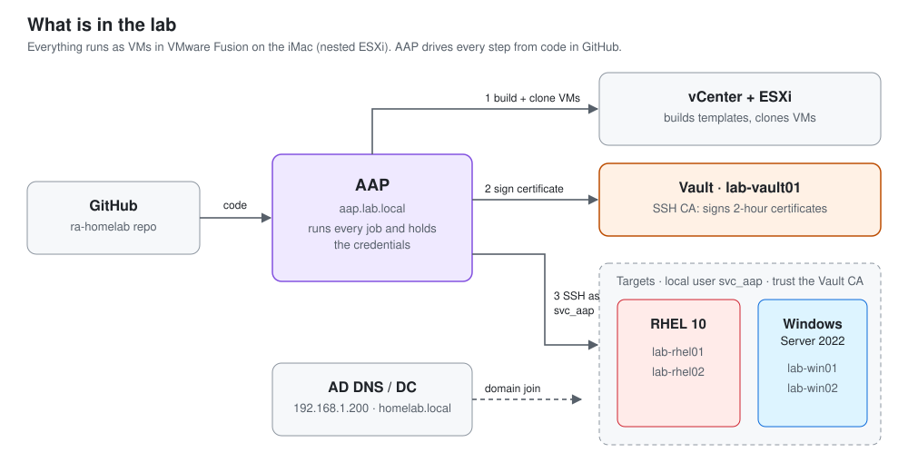
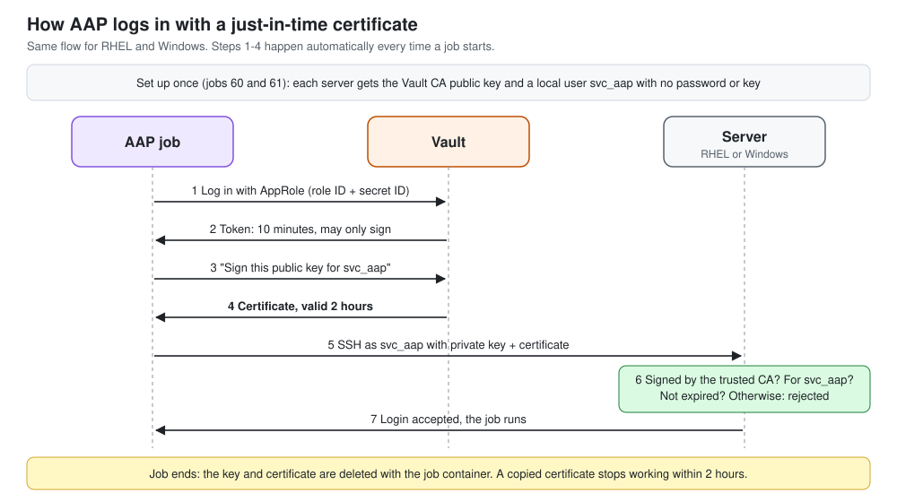
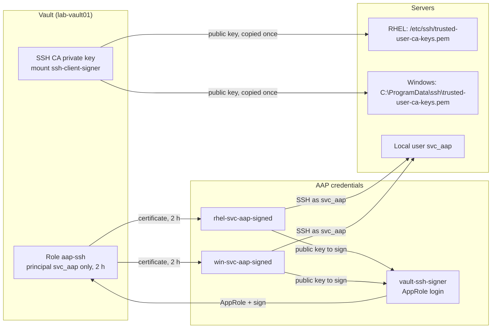
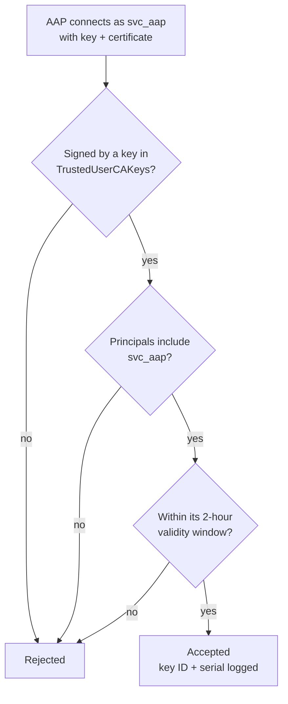
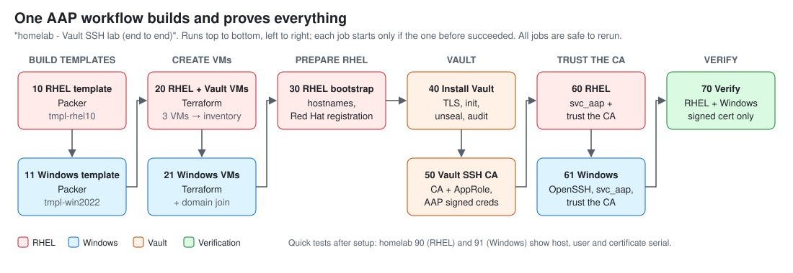

# ra-homelab design: just-in-time SSH certificates for AAP

> New here? Read [OVERVIEW.md](OVERVIEW.md) first (plain words, three pictures), then [SETUP.md](SETUP.md).

| | |
| --- | --- |
| Status | RHEL and Windows: built and verified end to end |
| Owner | Ram Adhikari |
| Last updated | 2026-11-15 |
| Repo | `github.com/RamAdhikari/ra-homelab` |

## 1. In one paragraph

Ansible Automation Platform (AAP) logs in to Linux and Windows servers **without
any stored password or long-lived SSH key**. Every time a job starts, AAP asks
HashiCorp Vault to sign a fresh SSH certificate that is valid for **2 hours** and
only for the user `svc_aap`. The servers trust Vault's certificate authority (CA),
so they accept the certificate, and nothing else, for that user. When the job ends
the certificate is thrown away with the job's temporary container, and it expires
on its own soon after. The whole lab, from building VM templates to proving the
login works, is code in this repo, run by one AAP workflow.

### Words used in this document

| Term | Meaning here |
| --- | --- |
| **SSH CA** | A key pair in Vault. Its private half signs certificates; its public half is copied to every server |
| **SSH certificate** | A user's public key plus Vault's signature, a list of allowed usernames (principals) and an expiry time |
| **Principal** | A username the certificate is valid for. Ours is only `svc_aap` |
| **JIT (just in time)** | The certificate is created at job start, used for that job, and expires shortly after |
| **svc_aap** | The local service account on each server that AAP logs in as |
| **AppRole** | How AAP proves its identity to Vault (a role ID plus a secret ID) |
| **Job template / workflow** | An AAP job definition / a chain of job templates |

### Goals

- Prove JIT certificate access from AAP to RHEL **and** Windows before using it on the work fleet.
- Everything as code in git, run by AAP, safe to rerun.
- No secrets in git: secrets live only in AAP credentials and on the Vault VM.

### Not in scope

- Production-grade Vault (high availability, KMS auto-unseal, CA-issued TLS). Section 12 lists the differences.
- Human SSH access and SSH host-key signing.

## 2. The lab



| Component | Address | Notes |
| --- | --- | --- |
| vCenter | `vcsa.homelab.local` (.157) | Datacenter `Virtual_DC`, cluster `My_Cluster`, SSO domain `homelab.local` |
| Workload ESXi | 192.168.1.155 | Datastore `LocalDS`, port group `VM Network`, folders `Templates`, `MyVMs` |
| AAP | `https://aap.lab.local` (.58) | Jobs reach it as `https://host.containers.internal` (section 13) |
| AD DNS / domain controller | 192.168.1.200 | Domain `homelab.local` |
| Vault | `lab-vault01` (.29) | Single node, port 8200, web UI at `/ui` |
| RHEL targets | `lab-rhel01` (.27), `lab-rhel02` (.28) | RHEL 10.1, not in DNS |
| Windows targets | `lab-win01`, `lab-win02` | Windows Server 2022, joined to `homelab.local` |

All VMs use DHCP. Jobs 20 and 21 write the current addresses into the AAP inventory on every run.

## 3. How a just-in-time login works

The flow is identical for RHEL and Windows; only the server side differs (OpenSSH
on Linux, OpenSSH Server for Windows).



Steps 1 to 4 are done by AAP's built-in **HashiCorp Vault Signed SSH** credential
type. The Machine credential's "Signed SSH Certificate" field is linked to it, so
the certificate is fetched automatically at every launch.

The servers never contact Vault. They check the certificate offline against the CA
public key. Vault only needs to be reachable from AAP; if Vault is down, running
jobs continue but new jobs cannot start.

| Property | How it is achieved |
| --- | --- |
| Issued per job | The certificate field is a Vault lookup that AAP runs at every job launch |
| Short-lived | Vault role TTL = max TTL = `ssh_cert_ttl` (7200 s, `vars/lab.yml`) |
| Not kept after the job | Key and certificate exist only in the job's temporary container and ssh-agent |
| One user only | The only principal is `svc_aap` |
| Traceable | Vault audit log records every signing; each server logs the certificate key ID and serial |

SSH certificates cannot be revoked one by one without a revocation list (KRL), so
the short lifetime is the control. A job longer than 2 hours keeps its open
connections but cannot open new ones; raise `ssh_cert_ttl` for such jobs.

## 4. The svc_aap service account

`svc_aap` is a **local** account on each server that exists only for AAP. It has no
usable password and no `authorized_keys`, so the only way in is a Vault-signed
certificate whose principal is `svc_aap`.

| Property | RHEL | Windows |
| --- | --- | --- |
| Account | Local user, `/bin/bash` | Local user (not a domain account) |
| Password | Locked | Random 36 characters, never stored or shown |
| Static keys | None | None |
| Privilege | Passwordless sudo (`ALL`, lab) | Member of local Administrators |
| Created by | Job 60 | Job 61 |

### Trust chain



Both Machine credentials hold the **same** `svc_aap` key and fetch a certificate the
same way; there are two only so job templates read clearly per OS.

### What the server checks at every login



A leaked certificate cannot be used for root, Administrator or any other user, and
stops working within 2 hours. The private key alone is useless because no server
has it in `authorized_keys`.

## 5. Automation: what runs where

### 5.1 One workflow



AAP › Templates › **homelab - Vault SSH lab (end to end)** › Launch. Each step runs
only if the previous one succeeded, and every step is safe to rerun.

| # | Job template | Runs on | What it does | Rerun behaviour |
| --- | --- | --- | --- | --- |
| 10 | build RHEL 10 template | job container | Packer builds `tmpl-rhel10` | Skips if it exists; `rebuild_template=true` replaces it |
| 11 | build Windows 2022 template | job container | Packer builds `tmpl-win2022` from the Server 2022 ISO on LocalDS (answer file on a floppy) | Skips if it exists; `rebuild_template=true` replaces it |
| 20 | provision RHEL and Vault VMs | job container | Terraform clones Vault + 2 RHEL VMs; writes IPs to the inventory | Plans first, applies only changes |
| 21 | provision Windows VMs | job container | Terraform clones 2 Windows VMs from `tmpl-win2022`, sets the local Administrator password, joins `homelab.local`; writes IPs to the inventory; group `win_targets` connects over OpenSSH + PowerShell | Plans first, applies only changes |
| 30 | bootstrap RHEL hosts | Vault + RHEL VMs | Hostname, `/etc/hosts`, Red Hat registration, Red Hat release key 4 | Registers only if not registered |
| 40 | install Vault | lab-vault01 | Signing keys, Vault, TLS, config, firewall, init, unseal, boot-time unseal, audit log | Init only once; unseal only if sealed |
| 50 | configure Vault SSH CA | Vault + job container | Terraform: CA, role, policy, AppRole. New secret ID and key; creates/updates both Machine credentials; publishes the CA public key as an inventory variable | Rotates the secret ID and key each run |
| 60 | RHEL trust SSH CA | RHEL VMs | `svc_aap` + sudo, CA key file, `TrustedUserCAKeys` | Idempotent |
| 61 | Windows OpenSSH and trust SSH CA | Windows VMs (WinRM, once) | OpenSSH Server (Windows feature, or Microsoft's Win32-OpenSSH 9.8.3 MSI when Windows Update is unreachable), firewall, PowerShell default shell, `svc_aap` in Administrators, CA key file, `TrustedUserCAKeys` | Idempotent |
| 70 | verify signed SSH (RHEL and Windows) | job container | Ad hoc `id -un` on RHEL and `win_ping` on Windows, both with signed credentials only | Read-only |

### 5.2 Test job templates

| Job template | Credential | Shows |
| --- | --- | --- |
| homelab 90 - RHEL connectivity check (signed cert) | `rhel-svc-aap-signed` | Per RHEL host: ping, hostname, user, OS, uptime, accepted certificate ID and serial |
| homelab 91 - Windows connectivity check (signed cert) | `win-svc-aap-signed` | Per Windows host: ping, hostname, domain, user, OS, uptime, accepted certificate ID and serial |
| homelab 80 - RHEL JIT certificate demo | `rhel-svc-aap-signed` | The certificate issued for the run (key ID, serial, principal, validity) and sudo working |
| homelab 81 - Windows JIT certificate demo | `win-svc-aap-signed` | The certificate issued for the run, the logged-in user, Administrator rights, and the OpenSSH login record |

Run any of them twice: the serial changes, because each run gets a new certificate.

### 5.3 AAP objects

| Object | Name | Created by |
| --- | --- | --- |
| Project | `ra-homelab` (git `main`, update on launch) | `aap/seed.yml` |
| Inventory | `homelab-lab`: groups `vault`, `rhel_targets` (RHEL), `win_targets` (Windows) | Seed; hosts by jobs 20/21; variables by job 50 |
| Credential types | `Homelab lab secrets`, `Homelab domain join` | Seed |
| Job templates and workflow | Section 5.1 and 5.2 | Seed (80/81/90/91 once their credentials exist) |
| Setting | `AWX_ISOLATION_SHOW_PATHS` += `/var/lib/homelab-tfstate` | Seed |

### 5.4 Credentials

| Credential | Type | Holds | Used by | Who creates it |
| --- | --- | --- | --- | --- |
| `homelab-github` | Source Control | GitHub PAT | Project | You |
| `homelab-vcenter` | VMware vCenter | vCenter user and password | 10, 11, 20, 21 | You |
| `homelab-lab-secrets` | Homelab lab secrets | `labadmin` password (also the Windows local Administrator password), Red Hat login | 10, 11, 21, 30, 61 | You |
| `homelab-domain-join` | Homelab domain join | AD account that joins Windows VMs | 21 | You |
| `homelab-labadmin` | Machine | `labadmin` + password (RHEL bootstrap) | 30, 40, 50, 60 | You |
| `homelab-aap-api` | Red Hat AAP | Host `https://host.containers.internal`, API token | 20, 21, 50, 70 | You |
| `vault-ssh-signer` | HashiCorp Vault Signed SSH | Vault URL, AppRole role ID + secret ID, Vault CA cert | The two below | Job 50 |
| `rhel-svc-aap-signed` | Machine | `svc_aap` + private key; certificate from Vault at launch | 70, 80, 90 | Job 50 |
| `win-svc-aap-signed` | Machine | Same key; certificate from Vault at launch | 70, 81, 91 | Job 50 |

### 5.5 Inside the job container

AAP runs every job in its default execution environment. Nothing extra is baked in:

- **Packer 1.11.2 and Terraform 1.9.8** are downloaded per job from `releases.hashicorp.com`, checked against the published SHA256 sums (`roles/hashicorp_tools`).
- **Terraform providers** (vsphere 2.12.0, vault 4.4.0) are downloaded the same way into a local mirror; `TF_CLI_CONFIG_FILE` makes Terraform use only that mirror, because `registry.terraform.io` was unreachable from jobs.
- **Kickstart CD for Packer**: there is no `xorriso`/`mkisofs` in the image, so job 10 installs `pycdlib` and puts a small `mkisofs` stand-in on `PATH`.
- **Collections** `awx.awx`, `ansible.windows`, `community.windows` install on project sync.

The AAP node therefore needs outbound HTTPS to HashiCorp, GitHub (also for the Win32-OpenSSH MSI), Galaxy and PyPI.

### 5.6 Terraform state

Job containers are thrown away after each job, so state is kept on the AAP host in
`/var/lib/homelab-tfstate`, which AAP mounts into every job.

| Stack | State file |
| --- | --- |
| `terraform/rhel-vms` | `rhel-vms.tfstate` |
| `terraform/win-vms` | `win-vms.tfstate` |
| `terraform/vault-config` | `vault-config.tfstate` |

The folder is labelled `container_file_t` for SELinux and mounted with no relabel
option. This suits VM-based or containerised AAP with one execution node; with
OpenShift or several execution nodes, use an S3 backend (for example MinIO).

### 5.7 Repo layout

```
aap/seed.yml                   AAP config as code (types, project, inventory, templates, workflow)
playbooks/10 ... 91_*.yml      one playbook per job template (11 = Windows template)
playbooks/tasks/terraform.yml  shared Terraform runner (init, plan, apply on change, outputs)
roles/hashicorp_tools/         downloads Packer, Terraform, providers; mkisofs stand-in
packer/rhel10/                 RHEL 10 template build and kickstart
packer/win2022/                Windows Server 2022 template build and answer file
terraform/rhel-vms/            Vault + RHEL VM clones
terraform/win-vms/             Windows VM clones with domain join
terraform/vault-config/        Vault SSH CA, role, policy, AppRole
vars/lab.yml                   shared non-secret settings
docs/DESIGN.md                 this document
```

## 6. VM templates

### RHEL 10 (`tmpl-rhel10`, built by job 10)

| Setting | Value |
| --- | --- |
| Source ISO | `[LocalDS] iso/rhel-10.1-x86_64-dvd.iso` |
| VM | 2 vCPU, 4 GB RAM, 40 GB thin, EFI, PVSCSI, VMXNET3 |
| Install | Kickstart on a Packer-made CD; boot command adds `inst.ks=cdrom:/ks.cfg` |
| Contents | Minimal install, open-vm-tools, python3; SELinux enforcing; firewalld with SSH only; root locked |
| User | `labadmin`, passwordless sudo, password from `homelab-lab-secrets` |
| Known gap | Ships an older `redhat-release` without Red Hat release key 4; job 30 fixes this on every clone |

RHEL clones are not guest-customised (this vCenter cannot customise RHEL 10
networking), so job 30 sets hostnames.

### Windows Server 2022 (`tmpl-win2022`, built by job 11)

| Setting | Value |
| --- | --- |
| Source ISO | `[LocalDS] en-us_windows_server_2022_updated_nov_2024_x64.iso` (release media) |
| Product key | Microsoft's public KMS client setup key for Server 2022 Standard; installs unattended, not activated (lab) |
| Edition | Windows Server 2022 Standard (Desktop Experience) |
| VM | 2 vCPU, 4 GB RAM, 40 GB thin, BIOS, LSI Logic SAS, VMXNET3 |
| Install | `autounattend.xml` and setup scripts on a Packer-made floppy (A:); VMware Tools from the ESXi tools ISO (E:) |
| Contents | VMware Tools, RDP and WinRM enabled, Server Manager off at logon, AUS Eastern time zone |
| Administrator | Password = `labadmin` password from `homelab-lab-secrets` |
| Generalisation | None at build time; vSphere guest customisation runs Sysprep on each clone |
| Clones | `lab-win01`, `lab-win02`: 2 vCPU, 4 GB RAM |
| Customisation | vSphere sets computer name, local Administrator password (= `labadmin` password), time zone (AUS Eastern), AD DNS, and joins `homelab.local` |
| First connection | Job 61 over WinRM (NTLM) as the local Administrator, once, to install OpenSSH and trust the CA (its play vars override the inventory) |
| After that | SSH only (inventory group vars: `ansible_connection: ssh`, `ansible_shell_type: powershell`), as `svc_aap` with a Vault-signed certificate |

## 7. Vault

| Item | Lab value |
| --- | --- |
| Deployment | Single node, integrated Raft storage |
| TLS | Self-signed, 825 days; SANs: FQDN, short name, IP, 127.0.0.1 |
| Seal | Shamir, 1 key share (lab only) |
| Init material | `/root/vault-init.json` on lab-vault01, mode 0600 (lab only) |
| After a reboot | `vault-lab-unseal.service` unseals from that file (lab only) |
| Audit | `/var/log/vault/audit.log` |
| SSH mount | `ssh-client-signer`; the CA private key never leaves Vault |
| Signing role | `aap-ssh` (one role for RHEL and Windows): user certificates only, principal `svc_aap`, `permit-pty`, `rsa-sha2-256`, TTL = max TTL = 2 h, key ID `aap-<token>-<keyhash>` |
| Policy | `aap-ssh-sign`: may only sign with role `aap-ssh` |
| AAP login | AppRole `aap-controller`: token 10 min (max 20), secret ID 90 days, both limited to `192.168.1.0/24` |

`rsa-sha2-256` matters: RHEL 8 and later reject SHA-1 `ssh-rsa` certificate signatures.

### Logging in to the Vault web UI

1. Open `https://192.168.1.29:8200/ui` and accept the self-signed certificate warning.
2. Method **Token**. Get the root token in a terminal (lab only):
   `ssh labadmin@192.168.1.29 "sudo python3 -c \"import json;print(json.load(open('/root/vault-init.json'))['root_token'])\""`
3. Look at **Secrets Engines › ssh-client-signer**, **Access › Auth Methods › approle**, **Policies › aap-ssh-sign**.

## 8. Security model

- **No standing access:** no stored password or static key opens a server for AAP; access exists only while a certificate is valid.
- **Least privilege at Vault:** AAP's Vault token can sign for one role and one principal, and a leaked secret ID is useless outside the allowed subnet.
- **Fast cut-off:** disable the AppRole or the role, and no new AAP access is possible; existing certificates die within 2 hours.
- **Traceability:** Vault audit log for every signing; sshd (RHEL) and the OpenSSH/Operational event log (Windows) record the key ID and serial.
- **Secrets outside git:** state, keys, plans and `.env` are in `.gitignore`.

Lab-only shortcuts, not for production: stored unseal key and root token, one key
share, self-signed TLS, whole-subnet AppRole binding, `0777` state folder,
`NOPASSWD: ALL` sudo and local Administrators membership for `svc_aap`,
`LocalAccountTokenFilterPolicy=1` on Windows, TLS verification off towards AAP and vCenter.

## 9. Operations

| Task | How |
| --- | --- |
| Run everything | Launch the workflow (section 5.1) |
| Quick health check | Launch job 90 (RHEL) or 91 (Windows) |
| Change code | Push to `main`; the project syncs on every launch |
| Change certificate lifetime | Edit `ssh_cert_ttl` in `vars/lab.yml`, push, rerun job 50 |
| Rotate the AppRole secret ID and AAP key | Rerun job 50 |
| Rebuild the RHEL template | Launch job 10 with `rebuild_template: true` |
| Add a RHEL target | Add it to `terraform/rhel-vms/terraform.tfvars` and `lab_vm_groups`, push, run the workflow |
| Add a Windows target | Add it to `terraform/win-vms/terraform.tfvars` and `lab_win_groups`, push, run the workflow |
| Vault sealed after a reboot | The boot service unseals it; otherwise rerun job 40 |
| Reseed AAP objects | `ansible-playbook aap/seed.yml` (safe to rerun) |
| Rotate the CA | Add the new CA key to `TrustedUserCAKeys` on all servers, switch the mount, then remove the old key |
| vCenter certificate | Reissued 2026-11-12, valid 2 years: renew before November 2028 |

## 10. Bringing it up from scratch

The full step-by-step guide, with every credential field, is [SETUP.md](SETUP.md). Summary:

1. Push the repo to GitHub.
2. In AAP create `homelab-github`, `homelab-vcenter`, `homelab-labadmin`, `homelab-aap-api`.
3. On the AAP host create `/var/lib/homelab-tfstate` (owned by `aap`, labelled `container_file_t`).
4. Run `ansible-playbook aap/seed.yml` from a machine with the AAP token. It creates the credential types and stops.
5. Create `homelab-lab-secrets` and `homelab-domain-join`, then rerun the seed. It creates the project, job templates and workflow.
6. Launch the workflow.
7. Run the seed once more to create test templates 80, 81, 90 and 91 (their credentials now exist).

## 11. Decisions

| Decision | Choice | Why |
| --- | --- | --- |
| Where automation runs | AAP for everything; the Mac only seeds once | Matches the work fleet; full audit trail in AAP |
| Windows access method | OpenSSH Server trusting the same Vault CA | One CA, one role, one pattern for both OS families; no passwords for AAP to hold |
| Windows template | Packer build in AAP (job 11), ported from the earlier lab Packer config | The existing `Win2022-VM-Template` pointed at a deleted disk; a build from code is reproducible |
| Credential per OS | Two Machine credentials with the same key | Clear job templates; one certificate pipeline |
| AAP API from jobs | `https://host.containers.internal` | Rootless Podman: the host's own IP loops back into the container |
| Collection for AAP config | `awx.awx` with `/api/controller/` prefix | On Galaxy, no Automation Hub token; prefix needed behind the AAP 2.5+ gateway |
| Tools in jobs | Download per job | No custom execution environment or registry needed for a lab |
| RHEL naming | Ansible after clone | vCenter cannot customise RHEL 10 |
| Object names | Say which OS a job or credential is for; shared objects (inventory `homelab-lab`, Vault role `aap-ssh`) are OS-neutral | The lab started RHEL-only; the seed renames older objects in place so job history is kept |

## 12. Lab vs production

| Lab | Production |
| --- | --- |
| 1 Vault node | 3+ nodes, Raft, one per failure domain, load balancer |
| Shamir, 1 share, key on disk | Auto-unseal with a cloud KMS or HSM; recovery keys split between people |
| Self-signed TLS | Certificate from the internal CA |
| Root token used by job 50 | Admin login via an auth method; root token revoked |
| AppRole limited to a /24 | Limited to the AAP execution node addresses |
| One role for RHEL and Windows | Separate roles (and principals) per OS and environment |
| svc_aap with full sudo / local admin | Sudo and admin rights limited to what automation needs |
| State on the AAP host | Remote backend with locking |
| Tools downloaded per job | Custom execution environment with pinned tools |

## 13. Problems found and fixed

| Problem | Cause | Fix |
| --- | --- | --- |
| vCenter UI: "no healthy upstream" | Machine SSL certificate expired 2026-08-05; `vpxd-svcs` and `vpxd` could not start | `certificate-manager` option 3; SSO admin password reset with `vdcadmintool` |
| Packer stopped at the graphical installer | Kickstart CD (OEMDRV) not auto-detected | Boot command adds `inst.ks=cdrom:/ks.cfg` |
| Packer version error on the Mac | Packer 1.8.6 | Constraint `>= 1.8.0`; AAP now downloads 1.11.2 |
| RHEL clone failed at customisation | vCenter cannot customise RHEL 10 | No customisation; job 30 sets hostnames |
| Vault install: "nothing provides openssl" | Clones not registered with Red Hat | Job 30 registers each VM |
| Galaxy TLS error on the Mac | Mac Python had no CA bundle | `SSL_CERT_FILE` built from the macOS keychain |
| AAP API 404, then 401 | `awx.awx` default path; password login disabled | `/api/controller/` prefix; API token |
| AAP rejected `:Z` | Only `z`, `O`, `ro`, `rw` allowed | Changed, then removed (next row) |
| Every AAP job failed: `lsetxattr ... not permitted` | Relabel of a root-owned folder on each job | Plain mount; folder owned by `aap`, labelled `container_file_t` |
| Seed: "Playbook not found for project" | Project had never synced | Seed always syncs the project first |
| Job 10: "could not find a supported CD ISO creation command" | No `xorriso`/`mkisofs` in the image | vCenter check first; `pycdlib` `mkisofs` stand-in for builds |
| Job 20: `terraform init` timed out | `registry.terraform.io` unreachable from jobs | Providers from `releases.hashicorp.com` into a local mirror |
| Job 20: AAP API timed out | Rootless Podman 5.6: host IP loops back; AAP host `/etc/hosts` maps the name to 127.0.0.1 and a stale .33 | `homelab-aap-api` host `https://host.containers.internal` |
| Job 40: "Public key for openssl ... is not installed" | RHEL 10.1 ISO lacks Red Hat release key 4 (ML-DSA-87+Ed448), which signs current updates (RHEL-144980) | Job 30 upgrades to `redhat-release-10.1-18` (old-key signed, carries key 4), falls back to `--nogpgcheck` for that package only, imports the key file |
| Job 60: permission denied on `vault.crt` | `/opt/vault/tls` readable only by `vault` | That play uses `become` |
| Job 11: Windows VM stuck on a black screen with a cursor | BIOS tried to boot the non-bootable answer-file floppy | `boot_order = "disk,cdrom"` |
| Job 11: still a black screen; Windows CD not connected | Content-library ISO path no longer existed | Build uses `en-us_windows_server_2022_updated_nov_2024_x64.iso` on LocalDS, with a setup key |
| Job 61: `Service 'sshd' is not installed` | The OpenSSH Windows feature downloads from Windows Update, unreachable from the VMs; the failure is non-fatal | Fallback installs Microsoft's Win32-OpenSSH MSI, downloaded by the job container |
| Job 70: ad hoc refused `ansible_connection` / `ansible_shell_type` | AAP forbids connection variables in ad hoc commands | SSH settings live in the `win_targets` group vars; job 61 overrides them for WinRM |
| Job 21: `Win2022-VM01.vmdk was not found` | `Win2022-VM-Template` points at a deleted disk | New template `tmpl-win2022` built by job 11 |

## 14. Open items

- [ ] Delete the broken `Win2022-VM-Template` in vCenter.
- [ ] Rotate secrets that were shared in chat: vCenter admin password, AAP API token, the `claude` AAP user password.
- [ ] DHCP reservations for the lab VMs.
- [ ] Rebuild `tmpl-rhel10` so its `labadmin` password matches the reset one.
- [ ] Clean up `/etc/hosts` on the AAP VM (`aap.lab.local` on 127.0.0.1 and a stale 192.168.1.33).
