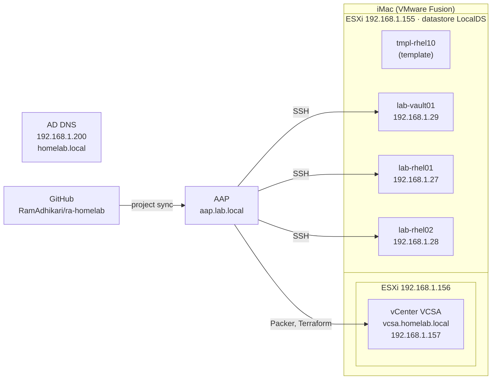
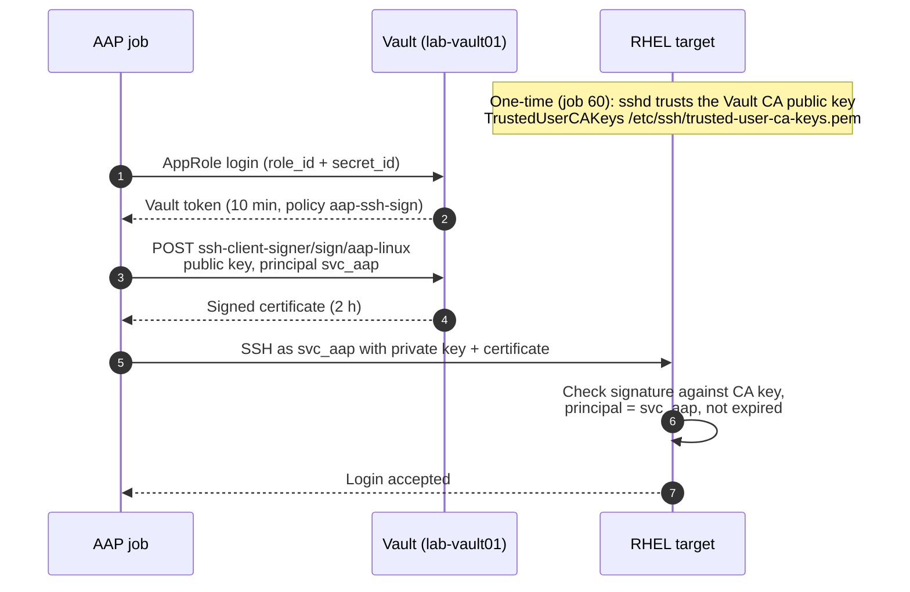
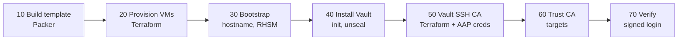

# ra-homelab design: AAP logs in to RHEL with Vault-signed SSH certificates

| | |
| --- | --- |
| Status | Built and seeded in AAP; first end-to-end workflow run pending |
| Owner | Ram Adhikari |
| Last updated | 2026-11-15 |
| Repo | `github.com/RamAdhikari/ra-homelab` |

## 1. Summary

Red Hat Ansible Automation Platform (AAP) connects to RHEL hosts with short-lived
SSH certificates signed by a HashiCorp Vault SSH certificate authority, instead
of a long-lived key in `authorized_keys`. AAP fetches a fresh certificate (valid
2 hours) from Vault every time a job starts; each host trusts the Vault CA's
public key and nothing else changes on it.

The whole lab, from the RHEL template to the final login test, is built by one
AAP workflow from this repo. Nothing runs on the Mac except a one-time seed of
the AAP objects.

### Goals

- Prove the Vault SSH CA pattern end to end before using it on the work fleet.
- Every step as code in git, run by AAP, safe to rerun.
- No secrets in git: all secrets live in AAP credentials or on the Vault VM.

### Non-goals

- Production-grade Vault (HA, auto-unseal with a KMS or HSM, CA-issued TLS).
  Section 11 lists what changes for production.
- Windows hosts, host-key signing, human SSH access.

## 2. Lab environment



| Component | Address | Notes |
| --- | --- | --- |
| vCenter | `vcsa.homelab.local` (192.168.1.157) | VCSA on ESXi .156; datacenter `Virtual_DC`, cluster `My_Cluster`, SSO domain `homelab.local` |
| Workload ESXi | 192.168.1.155 | Datastore `LocalDS`, port group `VM Network`, folders `Templates`, `MyVMs` |
| AAP | `https://aap.lab.local` | Controller API at `/api/controller/v2/` (AAP 2.5+ gateway) |
| AD DNS | 192.168.1.200 | Domain `homelab.local`; lab VMs are **not** registered in DNS |
| RHEL template | `tmpl-rhel10` | RHEL 10.1, built by Packer |
| Vault | `lab-vault01` (192.168.1.29) | Single node, port 8200 |
| SSH targets | `lab-rhel01` (.27), `lab-rhel02` (.28) | Trust the Vault CA |

VM addresses come from DHCP. Job 20 rewrites them into the AAP inventory on every run.

## 3. How a signed login works



AAP does steps 1 to 4 automatically through its built-in **HashiCorp Vault
Signed SSH** credential type: the Machine credential's "Signed SSH Certificate"
field is linked to it, so the certificate is fetched at job launch.

The host never contacts Vault. It validates the certificate offline against the
CA public key, so Vault only needs to be reachable from AAP. If Vault is down,
running jobs continue but new jobs cannot start.

## 4. Automation design

### 4.1 Repo layout

```
aap/seed.yml                   AAP config as code: credential type, project, inventory,
                               job templates, workflow, state-path setting
playbooks/10_build_template.yml  ... 70_verify.yml   one playbook per job template
playbooks/tasks/terraform.yml  shared Terraform runner (init, plan, apply on change, outputs)
playbooks/templates/vault.hcl.j2
roles/hashicorp_tools/         downloads pinned Packer and Terraform into the job container
packer/rhel10/                 vsphere-iso build + kickstart template
terraform/rhel-vms/            VM clones
terraform/vault-config/        Vault SSH CA, policy, AppRole
vars/lab.yml                   shared non-secret settings
collections/requirements.yml   awx.awx, installed by AAP on project sync
```

### 4.2 AAP objects

| Object | Name | Created by |
| --- | --- | --- |
| Project | `ra-homelab` (git, branch `main`, update on launch) | seed |
| Inventory | `homelab-rhel-lab`, groups `vault`, `rhel_targets` | seed; hosts written by job 20 |
| Credential type | `Homelab lab secrets` (build password, Red Hat login) | seed |
| Workflow | `homelab - Vault SSH lab (end to end)` | seed |
| Job templates | `homelab 10` … `homelab 70` (below) | seed |
| Setting | `AWX_ISOLATION_SHOW_PATHS` += `/var/lib/homelab-tfstate` | seed |
| Credentials with secrets | `homelab-github`, `homelab-vcenter`, `homelab-labadmin`, `homelab-aap-api`, `homelab-lab-secrets` | you, in the UI |
| Generated credentials | `vault-ssh-signer`, `rhel-svc-aap-signed` | job 50 |

| Credential | Type | Used by | Provides |
| --- | --- | --- | --- |
| `homelab-github` | Source Control | project | GitHub PAT for the private repo |
| `homelab-vcenter` | VMware vCenter | 10, 20 | `VMWARE_HOST/USER/PASSWORD` for Packer and Terraform |
| `homelab-lab-secrets` | Homelab lab secrets | 10, 30 | `PKR_VAR_build_password`, `RHSM_USERNAME`, `RHSM_PASSWORD` |
| `homelab-labadmin` | Machine | 30, 40, 50, 60 | SSH as `labadmin` (passwordless sudo) |
| `homelab-aap-api` | Red Hat Ansible Automation Platform | 20, 50, 70 | API token so jobs can update AAP itself. Host must be `https://host.containers.internal` (see section 12) |
| `vault-ssh-signer` | HashiCorp Vault Signed SSH | `rhel-svc-aap-signed` | Vault URL, AppRole role_id + secret_id, Vault CA cert |
| `rhel-svc-aap-signed` | Machine | 70, and any future job | `svc_aap` + private key; certificate fetched from Vault at launch |

### 4.3 The workflow



Each node runs only if the previous one succeeded. Every job is idempotent.

| Job | Runs on | What it does | Idempotence |
| --- | --- | --- | --- |
| 10 build template | job container | Asks the vCenter API whether `tmpl-rhel10` exists; if not (or `rebuild_template=true`), runs `packer build` | Skips Packer entirely when the template exists |
| 20 provision VMs | job container | Terraform clones 3 VMs; writes hosts, IPs and groups into the AAP inventory | Terraform plan: applies only on changes |
| 30 bootstrap hosts | lab VMs | Hostname, `/etc/hosts` for all lab VMs, Red Hat registration, repo check | Registers only if `subscription-manager identity` fails |
| 40 install Vault | lab-vault01 | HashiCorp repo, Vault, self-signed TLS, config, firewall, init, unseal, boot-time unseal service, file audit device | Init only when uninitialised; unseal only when sealed |
| 50 configure Vault SSH CA | vault + job container | Terraform for mount, CA, role, policy, AppRole; new secret_id; fresh AAP keypair; creates/updates the two AAP credentials | Terraform plan; credentials updated in place (rotates secret_id and key each run) |
| 60 trust SSH CA | rhel_targets | `svc_aap` user + sudo, CA public key file, `TrustedUserCAKeys` in sshd | File and line modules |
| 70 verify | job container | AAP ad hoc `id -un` on `rhel_targets` with `rhel-svc-aap-signed` | Read-only |

### 4.4 Tools inside the job container

AAP runs jobs in its default execution environment. Rather than building a
custom image, `roles/hashicorp_tools` downloads pinned releases (Packer 1.11.2,
Terraform 1.9.8) from `releases.hashicorp.com`, verifies them against the
published SHA256SUMS, and extracts them under `/tmp/hc-tools`. Packer plugins
download from GitHub at run time.

Terraform providers (vsphere 2.12.0, vault 4.4.0) are fetched the same way from
`releases.hashicorp.com` into a local filesystem mirror, and a CLI config file
(`TF_CLI_CONFIG_FILE`) tells Terraform to install only from that mirror. The
job container could not reach `registry.terraform.io` reliably.

Packer builds the kickstart CD with `xorriso` or `mkisofs`, and the default
execution environment has neither. For a build, job 10 installs `pycdlib` with
pip and puts a small `mkisofs` stand-in (`roles/hashicorp_tools/files/mkisofs`)
first on `PATH`. It writes an ISO 9660 image with Joliet and Rock Ridge, so the
installer sees `ks.cfg` under its real name. The AAP node therefore needs
outbound HTTPS to HashiCorp, GitHub, Galaxy and PyPI.

### 4.5 Terraform state

Job containers are thrown away after each job, so state lives on the AAP host
at `/var/lib/homelab-tfstate`, exposed to every job through AAP's
"Paths to expose to isolated jobs" setting.

| Stack | State file |
| --- | --- |
| `terraform/rhel-vms` | `/var/lib/homelab-tfstate/rhel-vms.tfstate` |
| `terraform/vault-config` | `/var/lib/homelab-tfstate/vault-config.tfstate` |

The folder is labelled `container_file_t` for SELinux and mounted without a
relabel option (a `:z`/`:Z` relabel fails on every job, project syncs included).
This works for VM-based and containerised AAP with a single execution node. For
OpenShift-based AAP or several execution nodes, move state to an S3 backend
(MinIO).

## 5. RHEL 10 template

| Setting | Value |
| --- | --- |
| Source | `[LocalDS] iso/rhel-10.1-x86_64-dvd.iso` |
| VM | 2 vCPU, 4 GB RAM, 40 GB thin disk, EFI, PVSCSI, VMXNET3 |
| Guest OS type | `rhel9_64Guest` (accepted by older ESXi builds) |
| Install | Kickstart from a Packer-generated CD; boot command adds `inst.ks=cdrom:/ks.cfg` |
| Packages | Minimal environment, open-vm-tools, perl, python3, tar |
| Security | SELinux enforcing, firewalld with SSH only, root locked |
| User | `labadmin`, wheel, passwordless sudo, password from `homelab-lab-secrets` |
| Locale | en_AU, Australia/Sydney |
| Generalisation | SSH host keys and machine-id cleared before conversion |
| Known gap | Ships `redhat-release` without release key 4; job 30 fixes this on every clone |

Clones are not guest-customised: this vCenter cannot customise RHEL 10 network
settings, so job 30 sets hostnames instead.

## 6. Vault design

| Item | Lab value |
| --- | --- |
| Deployment | Single node, integrated Raft storage, `/opt/vault/data` |
| TLS | Self-signed, 825 days; SANs: FQDN, short name, IP, 127.0.0.1 |
| Seal | Shamir, 1 key share (lab only) |
| Init material | `/root/vault-init.json` on lab-vault01, mode 0600 (lab only) |
| Boot | `vault-lab-unseal.service` unseals from that file after a reboot (lab only) |
| Audit | File device, `/var/log/vault/audit.log` |
| SSH mount | `ssh-client-signer`, CA key generated inside Vault |
| Signing role | `aap-linux`: user certs only, principal `svc_aap`, `permit-pty`, `rsa-sha2-256`, TTL and max TTL 2 h (`ssh_cert_ttl` in `vars/lab.yml`), key ID `aap-<token>-<keyhash>` |
| Policy | `aap-ssh-sign`: `create`, `update` on `ssh-client-signer/sign/aap-linux` only |
| AAP auth | AppRole `aap-controller`: token 10 min (max 20), secret_id 90 days, both bound to `192.168.1.0/24` |

`rsa-sha2-256` matters: RHEL 8 and later reject SHA-1 `ssh-rsa` certificate signatures.

## 7. Security model

- **Secrets:** only in AAP credentials (encrypted) and on the Vault VM. The repo's
  `.gitignore` excludes state, keys, `.env` and plans.
- **Least privilege:** AAP's Vault token can sign for one role and one principal; a
  leaked AppRole secret_id is useless outside the bound subnet.
- **Short-lived access:** certificates expire after 2 hours; removing the AppRole or
  the role stops all new AAP access immediately.
- **Traceability:** every signing is in the Vault audit log; the key ID appears in
  each host's sshd log.
- **Lab shortcuts (not for production):** stored unseal key and root token, one key
  share, self-signed TLS, whole-subnet CIDR binding, `0777` state folder,
  `NOPASSWD: ALL` sudo for `svc_aap`, TLS verification off towards AAP and vCenter.

## 8. Just-in-time certificates

| Property | How it is achieved |
| --- | --- |
| Issued per job | The Machine credential's certificate field is a Vault lookup, run by AAP at every job launch |
| Short-lived | Signing role TTL = max TTL = `ssh_cert_ttl` (7200 s); Vault refuses anything longer |
| Not kept after the job | AAP writes the key and certificate only into the job's temporary private data directory and ssh-agent, which are destroyed when the job ends |
| One principal | The certificate is valid only for `svc_aap` |
| Traceable | Vault audit log records each signing; each host's sshd log records the certificate's key ID and serial |

Job template **homelab 80 - run job with JIT certificate** (`playbooks/80_jit_certificate_demo.yml`)
uses only `rhel-svc-aap-signed`. It prints the certificate issued for that run
(key ID, serial, principal, validity window) and the matching sshd login record
on each target.

SSH certificates cannot be revoked one by one without a revocation list (KRL),
so the short TTL is the control. Jobs that run longer than the TTL keep their
existing connections but cannot open new ones; raise `ssh_cert_ttl` for those.

## 9. Operations

| Task | How |
| --- | --- |
| Run everything | AAP › Templates › `homelab - Vault SSH lab (end to end)` › Launch |
| Change code | Commit and push to `main`; the project syncs on launch |
| Rebuild the template | Launch job 10 with `rebuild_template: true` |
| Rotate the AppRole secret_id and AAP key | Rerun job 50 (does both) |
| Add a target host | Add it to `vms` in `terraform/rhel-vms/terraform.tfvars` and to `lab_vm_groups` in `vars/lab.yml`, push, run the workflow |
| Vault sealed after a reboot | The boot service should unseal it; otherwise rerun job 40 |
| Reseed AAP objects | `ansible-playbook aap/seed.yml` (safe to rerun) |
| Rotate the CA | `TrustedUserCAKeys` accepts several keys: add the new CA key on hosts, switch the mount, then remove the old key |
| vCenter certificate | Machine SSL certificate reissued 2026-11-12, valid 2 years: renew before November 2028 |

## 10. Production differences

| Lab | Production |
| --- | --- |
| 1 Vault node | 3+ nodes, Raft, one per failure domain, load balancer |
| Shamir 1 share, key on disk | Auto-unseal with a cloud KMS or HSM; recovery keys split between people |
| Self-signed TLS | Certificate from the internal CA |
| Root token used by job 50 | Admin token from an auth method, root token revoked |
| AppRole bound to /24 | Bound to the AAP execution node addresses |
| One environment | Separate mount or cluster per environment |
| State on the AAP host | Remote backend with locking (S3 + DynamoDB, Terraform Cloud) |
| Packer/Terraform downloaded per job | Custom execution environment with pinned tools |

## 11. Decisions

| Decision | Choice | Reason |
| --- | --- | --- |
| Where automation runs | AAP for everything; Mac only seeds once | Matches how the work fleet is run; audit trail in AAP |
| Collection for AAP config | `awx.awx` with `/api/controller/` prefix | On Galaxy, no Automation Hub token; prefix needed for the AAP 2.5+ gateway |
| AAP API auth | Token | AAP gateway rejects password login on the controller API |
| Tools in jobs | Download at run time | No custom EE or registry needed for a lab |
| VM naming | Ansible after clone | vCenter guest customisation fails for RHEL 10 |
| Inventory | Static hosts updated by job 20 | No DNS for lab VMs; avoids the vCenter inventory plugin's DNS dependency |
| Kickstart delivery | CD + explicit `inst.ks=` | OEMDRV auto-detection did not fire |

## 12. Problems found and fixed

| Problem | Cause | Fix |
| --- | --- | --- |
| vCenter UI: "no healthy upstream" | Machine SSL certificate expired 2026-08-05, so `vpxd-svcs` and `vpxd` could not start | `certificate-manager` option 3; SSO admin password reset with `vdcadmintool` |
| Packer build stopped at the graphical installer | Kickstart CD (OEMDRV) not auto-detected | Boot command edits the entry and adds `inst.ks=cdrom:/ks.cfg` |
| Packer version error | Mac had Packer 1.8.6 | Version constraint lowered to `>= 1.8.0`; AAP now downloads 1.11.2 |
| Terraform clone failed at customisation | vCenter cannot customise RHEL 10 networking | Customisation removed; hostnames set by job 30 |
| Vault install: "nothing provides openssl" | Clones not registered with Red Hat, so no BaseOS/AppStream | Job 30 registers each VM |
| `ansible.posix` / `awx.awx` not found on the Mac | Mac Python had no CA bundle, Galaxy TLS failed | `SSL_CERT_FILE` built from the macOS keychain |
| AAP API 404, then 401 | `awx.awx` default `/api/` path; password login disabled | `CONTROLLER_OPTIONAL_API_URLPATTERN_PREFIX=/api/controller/`; API token |
| AAP rejected `:Z` mount option | Only `z`, `O`, `ro`, `rw` allowed | Changed, then removed (below) |
| Every AAP job failed: `lsetxattr ... operation not permitted` | Relabel of a root-owned folder on each job | Plain mount; folder owned by `aap` and labelled `container_file_t` |
| Seed: "Playbook not found for project" | Project never synced successfully; seed did not resync | Seed now always syncs the project first |
| Job 20: `terraform init` timed out on registry.terraform.io | Registry unreachable from the job container | Providers fetched from releases.hashicorp.com into a filesystem mirror |
| Job 20: AAP API timed out from the job (`aap.lab.local`) | Rootless Podman 5.6 gives containers the host's IP, so the host IP loops back; AAP host `/etc/hosts` also maps the name to 127.0.0.1 and a stale .33 | `homelab-aap-api` host set to `https://host.containers.internal` |
| Job 40: "Public key for openssl ... is not installed" | RHEL 10.1 ISO ships an older `redhat-release` without Red Hat release key 4 (ML-DSA-87+Ed448), which signs current updates (RHEL-144980) | Job 30 upgrades to `redhat-release-10.1-18` (old-key signed, ships key 4), falls back to `--nogpgcheck` for that one package, then imports the key file |
| Job 10: "could not find a supported CD ISO creation command" | No xorriso/mkisofs in the AAP execution environment | Template existence checked first via the vCenter API; pycdlib-based `mkisofs` stand-in for rebuilds |

## 13. Open items

- [ ] First end-to-end workflow run.
- [ ] Real Red Hat password in `homelab-lab-secrets` (job 30 needs it).
- [ ] Rotate secrets that were shared in chat: vCenter admin password, AAP API
      token, the `claude` AAP user password.
- [ ] DHCP reservations for the three lab VMs.
- [ ] Rebuild `tmpl-rhel10` so its `labadmin` password matches the reset one.
- [ ] Optional: add `lab-*` A records to AD DNS.
- [ ] Clean up `/etc/hosts` on the AAP VM (`aap.lab.local` on 127.0.0.1 and stale 192.168.1.33; real IP 192.168.1.58).
