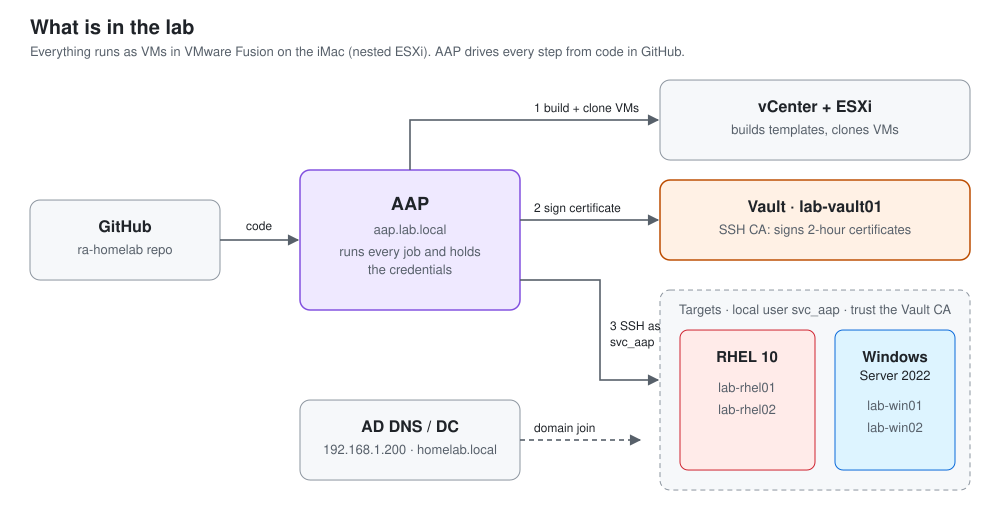
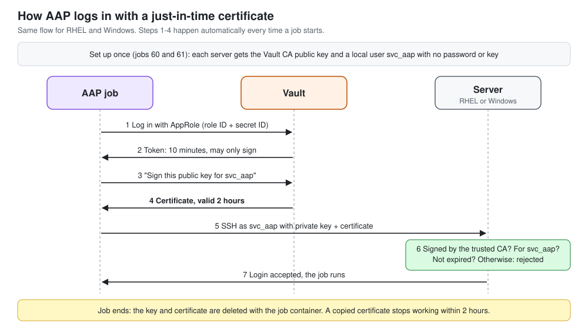
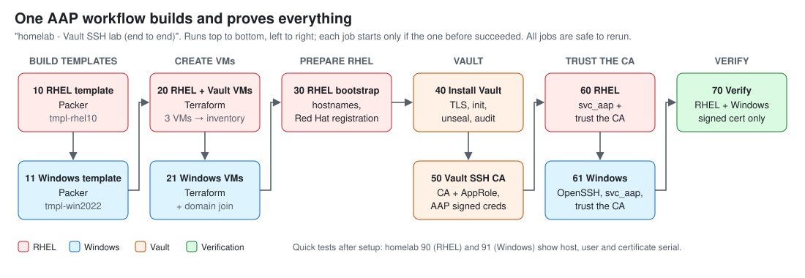

# ra-homelab in plain words

**Start here.** This page explains the idea with three pictures. For the
step-by-step setup see [SETUP.md](SETUP.md); for every detail see [DESIGN.md](DESIGN.md).

## The problem

Automation tools like AAP usually log in to servers with a password or an SSH key
that never changes. Whoever gets hold of it can log in to every server, at any
time, for as long as nobody notices.

## The idea

Give AAP a **fresh, short-lived pass for every job** instead of a permanent key:

- **HashiCorp Vault** acts as a certificate authority (CA). It signs SSH
  certificates, like a passport office stamping passports.
- Every server trusts Vault's stamp, and nothing else, for one local account: **`svc_aap`**.
- When an AAP job starts, AAP asks Vault for a certificate. It is valid for **2 hours** and only for `svc_aap`.
- When the job ends, the certificate is thrown away. If it leaked, it would stop working within 2 hours.

It works the same way for **RHEL** and **Windows** servers (Windows runs OpenSSH Server).

## What is in the lab

| Part | Role |
| --- | --- |
| GitHub `ra-homelab` | All the code: Packer, Terraform, Ansible playbooks, AAP configuration |
| AAP | Runs every job and holds every credential |
| vCenter + ESXi | Where templates are built and VMs are cloned |
| Vault (`lab-vault01`) | Signs the SSH certificates |
| RHEL and Windows targets | The servers AAP manages; each has `svc_aap` and trusts the Vault CA |
| AD (`homelab.local`) | The Windows VMs join the domain |

## How a login works

Nothing is stored on the server for AAP: no password, no key. The server only
checks three things: *Was this signed by the Vault CA? Is it for `svc_aap`? Is it
still within its 2 hours?*

## How it all gets built

One AAP workflow builds the whole lab from the code in GitHub and ends by
proving that AAP can log in to every server with a certificate only. Rerunning it
is safe: anything already in place is skipped.

## Try it

| To see | Run in AAP |
| --- | --- |
| The whole lab built and verified | **homelab - Vault SSH lab (end to end)** |
| Each RHEL server: host, user, certificate serial | **homelab 90 - RHEL connectivity check (signed cert)** |
| Each Windows server: host, domain, user, certificate serial | **homelab 91 - Windows connectivity check (signed cert)** |
| The certificate a job received, with its 2-hour validity | **homelab 80 - RHEL JIT certificate demo** |

Run a check twice: the certificate serial changes, because every run gets a new certificate.
